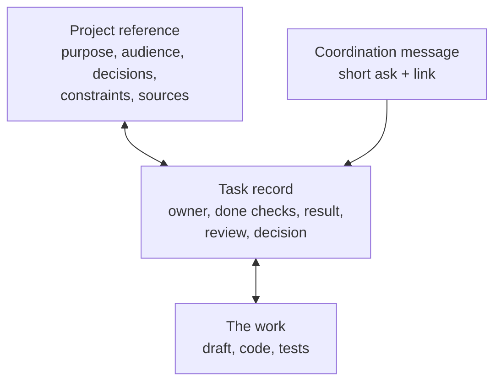
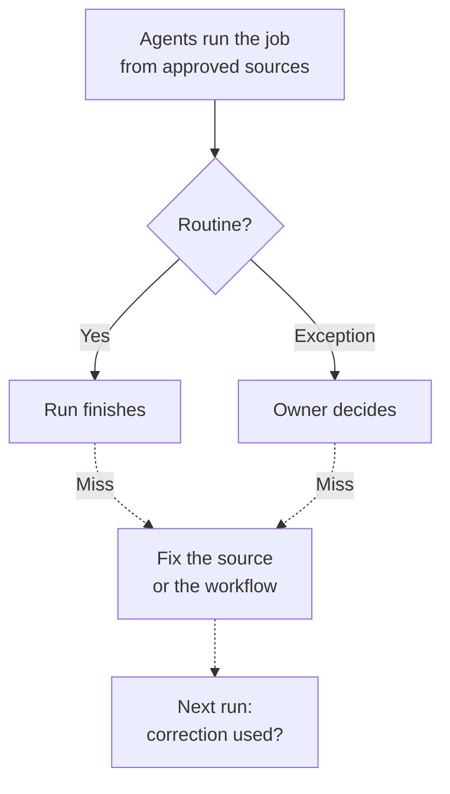

# Maestro Setup

A practical guide to getting more useful work from AI agents with less effort: decide who owns the outcome, what context they need, and how you will check the result. It's a practice, not an app to install.

**Start here:** the [starter guide](docs/START-HERE.md) sets up the whole workflow in six steps, with copyable prompts.

One assistant is enough if it covers your work. Several tools or a team work too; shared records help move work, but aren't automatic failover.

## Setup, Brain, Spine

- **Setup:** me, the agents and the tools.
- **Brain:** shared project context: purpose, decisions, constraints and sources.
- **Spine:** the path from request through one owner, delivery and review to a recorded result.

![Diagram titled "Maestro Setup", in three parts. SETUP: three tiles aligned over the steps below them: Accountable agents, Reviewers, and Me (human) (judgment and acceptance). SPINE: five steps left to right: Request, Accountable agent, Delivery, Reviewers + human decision, Recorded result (in the task record). A dashed coral arc labelled "Not yet" loops from the decision back to Delivery. "Accepted" sits over the arrow into Recorded result. BRAIN: a solid green layer across the full width, "Shared context: purpose, constraints, sources". Three arrows labelled "reads" rise from it into Accountable agent, Delivery, and Reviewers + human decision.](images/maestro-readme-light-v7.1.png#gh-light-mode-only)
![Diagram titled "Maestro Setup", in three parts. SETUP: three tiles aligned over the steps below them: Accountable agents, Reviewers, and Me (human) (judgment and acceptance). SPINE: five steps left to right: Request, Accountable agent, Delivery, Reviewers + human decision, Recorded result (in the task record). A dashed coral arc labelled "Not yet" loops from the decision back to Delivery. "Accepted" sits over the arrow into Recorded result. BRAIN: a solid green layer across the full width, "Shared context: purpose, constraints, sources". Three arrows labelled "reads" rise from it into Accountable agent, Delivery, and Reviewers + human decision.](images/maestro-readme-dark-v7.1.png#gh-dark-mode-only)

> **In my case:** Dot (ChatGPT) runs projects, Muse personal work, Claude delivery, Grok Bots specialist help. Notion holds the Brain, Linear the tasks, Slack the conversations.

## The Spine

One owner per request, with written done checks; review sends work back or records the result.

### One real workflow: launching the Lunar Wave website

- **Request:** a website for Lunar Wave, my product and AI practice.
- **Owner:** one agent, with written done checks; a second built the site.
- **Delivery:** private previews, a noindex public review build and a rollback path.
- **Review and decision:** links, contact and mail tested; I approved one exact launch action.
- **Recorded result:** live-site checks on the task; email authentication left open there.

**Knowledge moves through the records.** Elsewhere, an agent found that searches ignored a saved view's filters unless spelled out, and wrote the fix into the shared task method. Another agent on another platform read it and searched correctly without me relaying it.

## The Brain

A starting point for a fresh session, not shared memory: each agent keeps its own, and access to a page doesn't prove anyone read it.

One current home for each fact; everything else links to it. Keep passwords, keys and private details off them.

## How it runs

- Owners, done checks and reviews come from written rules, not technical controls.
- Routine work is accepted within delegated authority; reserved decisions come to me.
- A sent message doesn't prove pickup, so one agent carries a project through.

## What repeat work needs

A factory is a shared workflow for a repeated job. Agents run it from approved sources and routine runs finish on their own; people own the rules and handle the exceptions. Start where the output is easy to check.

**Example: deck review.** In my work, a deliberate human check: the writer checks the export, then a fresh reader follows it without speaker notes. A recurring problem gets fixed in the checklist or template, then checked on the next deck.

**Keeping guidance current.** An agent or reviewer flags a gap with evidence; the record's owner checks the source and makes the fix.

## Set it up yourself

Follow the [starter guide](docs/START-HERE.md) and adapt the [standard operating-rules example](docs/STANDARD-OPERATING-RULES.md) to each assistant. Plan eligibility and connector capabilities vary.

## Related work

My earlier project, [Maestro Spine](https://github.com/ahmadalkabra/maestro-spine), adapted rules, templates and scripts for AI-assisted work from Garry Tan's MIT-licensed gstack and gbrain. Maestro Setup doesn't build on its code.

## About

Ahmad Alkabra. Licensed under MIT. Copyright (c) 2026 Ahmad Alkabra.

[LinkedIn](https://www.linkedin.com/in/aalkabra) · X: [@ahmadalkabra](https://x.com/ahmadalkabra)
