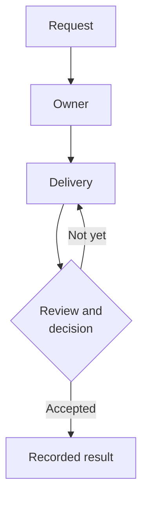

# Maestro Setup

I want more useful work from AI agents, with less of my effort. The useful part is deciding who owns the outcome, what context they need, and how I will check the result.

## Set it up yourself

Set up the whole frame, start with one real task, then refine in use. The [starter guide](docs/START-HERE.md) walks through roles, required connections, shared context, verification and real work, with copyable prompts and official resources. Adapt the separate [standard operating-rules example](docs/STANDARD-OPERATING-RULES.md) to each assistant's job and boundaries.

Use the assistants and workspace tools you already have where they support the required connections and access. You do not need the presentation or a particular team of agents; plan eligibility and connector capabilities vary.

## Three names

**Setup** is the whole arrangement of me, agents and tools.

**Brain** is the shared project context and knowledge: purpose, current decisions, constraints and useful sources. Each agent keeps its own memory.

**Spine** is the path a request follows: it gets an owner, moves through delivery and review, and ends with a decision or recorded result.

![Diagram titled "Maestro Setup", in three parts. SETUP: three tiles aligned over the steps below them: Accountable agents, Reviewers, and Me (human) (judgment and acceptance). SPINE: five steps left to right: Request, Accountable agent, Delivery, Reviewers + human decision, Recorded result (in the task record). A dashed coral arc labelled "Not yet" loops from the decision back to Delivery. "Accepted" sits over the arrow into Recorded result. BRAIN: a solid green layer across the full width, "Shared context: purpose, constraints, sources". Three arrows labelled "reads" rise from it into Accountable agent, Delivery, and Reviewers + human decision.](images/maestro-readme-light-v7.1.png#gh-light-mode-only)
![Diagram titled "Maestro Setup", in three parts. SETUP: three tiles aligned over the steps below them: Accountable agents, Reviewers, and Me (human) (judgment and acceptance). SPINE: five steps left to right: Request, Accountable agent, Delivery, Reviewers + human decision, Recorded result (in the task record). A dashed coral arc labelled "Not yet" loops from the decision back to Delivery. "Accepted" sits over the arrow into Recorded result. BRAIN: a solid green layer across the full width, "Shared context: purpose, constraints, sources". Three arrows labelled "reads" rise from it into Accountable agent, Delivery, and Reviewers + human decision.](images/maestro-readme-dark-v7.1.png#gh-dark-mode-only)

## The Spine

> In words: a request names an outcome you can check. It gets one owner with sources, limits and done checks. The owner returns the result, the checks they ran, and any remaining gaps. Review decides: if it isn't there yet, it goes back to delivery; if it's accepted, the result is recorded on the task record.

## The Brain

It gives a fresh session a starting point. It is not shared memory. Each agent keeps its own memory, and access to a page is not proof that anyone read it.

- **Project reference**
  - **Holds:** Purpose, audience, current decisions and why, constraints, sources
  - **Links to:** each open task record
- **Task record**
  - **Holds:** Owner, done checks, the result, the review, the recorded decision
  - **Links to:** the project reference, and the work itself
- **The work**
  - **Holds:** The draft, the code, the tests
  - **Links to:** its task record
- **Coordination message**
  - **Holds:** A short ask, plus a link to the task record
  - **Links to:** the task record

One current home for each fact; everything else links to it. Keep passwords, keys and private personal details off these pages.

This is a setup I use in my own work, not software you can install. Each task's owner, done checks and review come from written rules the agents are asked to follow. Written rules are not technical controls. Routine work can be accepted within delegated authority; decisions I reserve still come to me. The diagram's human-decision step represents those reserved decisions, not a new approval gate for every task.

In practice, cross-agent handoffs still need checking. Sending a message does not prove another agent picked it up. I now prefer one agent to carry a project through, adding a second reviewer where it helps.

## Related work

[Maestro Spine](https://github.com/ahmadalkabra/maestro-spine) is my earlier project: rules, templates and scripts for AI-assisted work, adapted from Garry Tan's MIT-licensed gstack and gbrain. Maestro Setup doesn't build on its code.

[atlas-dashboard](https://github.com/ahmadalkabra/atlas-dashboard) is an independent analytics dashboard I designed and built for Rootstock bridge activity (May 2026 snapshot).

## About

Ahmad Alkabra. Licensed under MIT. Copyright (c) 2026 Ahmad Alkabra.

[LinkedIn](https://www.linkedin.com/in/aalkabra) · X: [@ahmadalkabra](https://x.com/ahmadalkabra)
