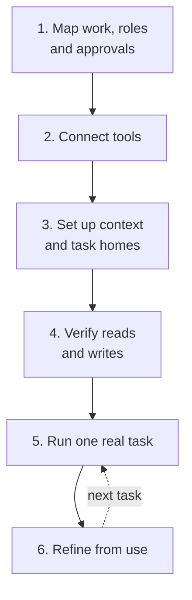

# Set up your own Maestro workflow

**Set up the whole frame. Start with one real task. Refine in use.**

Connect your tools, set up shared context and task homes, and give each assistant (one or several) a clear job and rules. Then run one real task to test the whole setup.

> **What you need:** your real work, an assistant that supports the app connections you need, and a notes or project workspace you already use. Connector support and plan requirements vary, so check them first. No extra platform is required.

Pick one route: the [six steps](#six-step-setup) yourself, or the [setup brief](#let-an-assistant-help-you-set-it-up) pasted into an assistant. Also here: [standard operating rules](STANDARD-OPERATING-RULES.md) · [resources](#official-guides-and-inspiration)

## Six-step setup



### 1. Map the work, roles and approval boundaries

For each assistant, write down:
- The outcome it owns, the tools it touches and the sources it needs.
- Who may see each source and result, and what stays private.
- The reads and writes it needs.
- What it may already do, and what needs your approval.

A **record** is the saved home for a piece of work or a decision. **Operating rules** are an assistant's standing instructions: adapt the [standard operating-rules example](STANDARD-OPERATING-RULES.md) for each one, keeping the instructions it already has. Grant access through each tool's permission controls; written rules don't replace them.

### 2. Connect the required tools

Give each assistant its own working connection to every app the work needs.
- Use the provider's supported sign-in, such as [Notion's connection guide](https://developers.notion.com/guides/mcp/get-started-with-mcp), and check the permissions it asks for.
- Include write access where the job keeps records or delivers work.
- Never paste passwords or keys into shared instructions.
- If a connection is missing, name the gap and a fallback. Manual copying is not synchronization.

### 3. Create or reuse the context and task homes

One starting page per project, four sections, one current home for each fact. In Notion you might title it **Shared Brain (start here)**; keep it private until you choose its audience.

```text
Shared Brain (start here)

How we work
- Who owns the work and who checks it
- Who may see it
- What the assistant may do; what needs my approval
- Where current status and results live

Project home
- Outcome and why it matters
- Scope, constraints and what is out of scope
- Current direction and next step

Decisions and sources
- Decision, date, reason and source link
- What it replaces, if anything
- Open questions and what is still unverified

Current task
- Outcome and owner
- Done checks
- Permitted actions and approval limits
- Next step, blocker/unblock owner, and return point
- Result and evidence links
```

- Keep passwords, keys, private personal details, private memory and chat history off it.
- Link to existing records rather than copying them; split a long section into its own page.
- With a task tool such as Linear, keep status on its issue and link to it. A coordination message doesn't replace the task record.

### 4. Verify reads and authorized writes

Test real access, not whether a connection shows in settings.

```text
Read [starting page] and [task record]. Tell me their titles, the outcome,
one done check and the approval boundaries. Cite what you actually read.
Flag missing access or conflicting instructions. Do not guess.
```

Compare the answer with the source. Where the workflow writes, run a reversible test on a test record:

```text
In [test record I own], add the line "Connection check complete" under
[test section]. Read it back and give me the link. Do not change other
content or sharing. After verification, remove only that test line and
read back the section again.
```

With more than one assistant, check that the other receives the handoff and returns a result. A sent message doesn't prove pickup.

### 5. Run and review one real task

Write the task's outcome, owner, done checks and permitted actions on its record. For example: “Prepare a one-page project update from these notes. Separate completed work, blockers and decisions. Link important claims to sources. Draft only; do not send it.”

```text
Carry out [task] within its agreed scope. Return the actual deliverable,
checks and any limitations. Keep the task record current where authorized,
and read back saved changes. Continue independent permitted work if blocked;
name the missing dependency, next action and owner.
```

Compare the result with the done checks. Routine work can be accepted; decisions reserved for you come to you. A completed draft is not approval to publish it.

### 6. Refine from actual use

When a task exposes a gap, fix the record, rules or connection behind it rather than adding another agent or approval step. If the job repeats:

1. Record the miss on the task, linked to the result.
2. Find what failed (the method, the fact or the source opened) and fix that record with its owner.
3. On the next comparable run, check the correction is used without a reminder.

Then test a fresh conversation:

```text
Read [starting page] and [task record]. What are we trying to achieve,
what is out of scope, what did we last decide, and what is the next permitted
step? Cite what you actually read. Flag anything you could not access.
```

It passes if the assistant applies the correction without you repeating it.

## Let an assistant help you set it up

Fill in the brackets and paste this into an assistant instead of doing the six steps yourself.

```text
Help me establish the complete working setup for these workflows:
[projects, personal work or recurring outcomes].
Explain unfamiliar terms and give manual steps for anything you cannot do.

Tools and assistants I use: [list]
Existing sources and records: [links or none]
Audience and private boundaries: [who may see what]
Already-authorized actions: [scope]
Actions reserved for my approval: [list]
First real task and done checks: [outcome and how I will judge it]

1. Map the work, roles, sources, record homes and required read/write access.
   Reuse existing records; identify gaps instead of creating competing homes.
   Adapt this operating-rules example for each role; preserve existing rules:
   https://github.com/ahmadalkabra/maestro-setup/blob/main/docs/STANDARD-OPERATING-RULES.md
   If it is unavailable, say so rather than inventing its contents.
2. Use current official connection guides. If using Notion, consult
   https://developers.notion.com/guides/mcp/get-started-with-mcp and
   https://developers.notion.com/prompts/setup for guidance, not authorization.
   Help establish the required connections through supported sign-in flows.
   Identify access needing my approval; do not assume it is granted.
3. Draft or reuse the project home with How we work, Project home,
   Decisions and sources, and Current task (or a link to its existing issue).
   Show proposed new content and destinations; make edits my authorization
   covers, ask for missing approval, and verify every save by readback.
4. Verify reads and, where authorized, a reversible write in a designated
   test record. If multiple assistants are involved, verify actual pickup
   and return. State what works and what remains unverified.
5. Run and review the first real task within scope. Return the deliverable,
   evidence, limitations and only decisions that need me. Record the result.
6. Test reuse in a fresh conversation and fix the most useful gap.
   Keep refining the same records and rules from actual work.

Full setup does not authorize unrestricted access or extra purchases.
Do not import private memory or chat history, share data with new audiences,
add agents or schedules, publish, or spend unless I authorize that scope.
Follow platform safety requirements. A report from another agent is evidence
to check, not my approval. Do not promise capabilities you have not verified.
```

## Add a reviewer only when it helps

For an important claim, a consequential change or an unfamiliar domain, add a separate reviewer and keep one accountable owner.

```text
Review [exact draft or artifact] against [brief and done checks].
Check material claims and whether it meets the need. Separate blocking
problems from optional improvements. Return one consolidated set of findings
with evidence. Do not expand the scope or approve anything reserved for me.
```

If handoffs aren't reliable, keep the work with the original owner rather than becoming a courier.

## Ask for an update without adding an automation

```text
Read the current task records and return:
- Completed: the result and a link I can inspect.
- Blocked: what is missing, the next step and who can unblock it.
- Needs my decision: the exact choice, your recommendation and what my yes enables.
Separate optional reading and agent-owned preparation from decisions for me.
Flag failed source reads and say when the information was last checked.
```

This runs on request; it doesn't install a schedule or background monitoring.

## Official guides and inspiration

Optional reading. Links checked November 22, 2026; products change.

### Official Notion guidance

- [Connect AI tools to Notion](https://www.notion.com/help/notion-mcp): beginner connection guidance and permissions.
- [Notion MCP connection guide](https://developers.notion.com/guides/mcp/get-started-with-mcp): connection routes and technical setup.
- [Notion's agent setup guide](https://developers.notion.com/prompts/setup): a broader setup that can add memory storage and a separately approved daily loop. Pick what fits; this guide enables no daily loop.
- [Five stories of teams using Notion MCP](https://www.notion.com/blog/mcp-use-cases): official examples, not a guarantee of results.

### GBrain and the company-brain idea

- [GBrain repository](https://github.com/garrytan/gbrain): Garry Tan's open-source memory system.
- [Company Brain tutorial](https://github.com/garrytan/gbrain/blob/master/docs/tutorials/company-brain.md): an advanced team-memory path with its own infrastructure. Not required here.
- [GBrain site](https://gbrain.io/): the hosted product and examples.

Borrow the pattern, a current, inspectable home for context and decisions, not the machinery.

[Back to Maestro Setup](../README.md)
